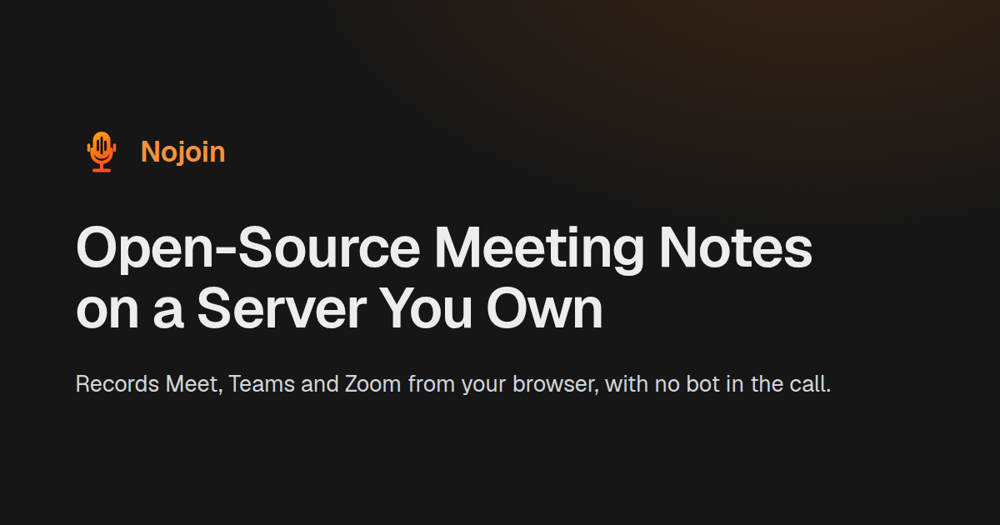

<!-- markdownlint-disable -->
<div align="center">
    
    <p>
        
        
    </p>
    <p>
        <a href="https://demo.nojoin.co.uk">Live Demo</a> · <a href="https://www.nojoin.co.uk">Website</a> · <a href="docs/README.md">Docs</a> · <a href="https://www.nojoin.co.uk/compare/">How It Compares</a> · <a href="https://www.nojoin.co.uk/managed/">Managed Nojoin</a>
    </p>
</div>

Nojoin records your Meet, Teams and Zoom calls from the browser and transcribes them on your own hardware, so no bot joins the call and the audio stays with you. Connect Claude or ChatGPT and they can read and edit the whole library.

## Why Nojoin?

- **Your assistant works on your meetings.** A built-in [MCP server](docs/MCP.md) gives Claude, ChatGPT and other clients 32 tools, 19 of which write: search every meeting and document, fix a misheard line, file the action items as tasks, reconcile attendees with your CRM. The most an assistant can delete is a move to the bin.
- **Speakers recognised across meetings.** Name someone once and their voiceprint matches them in later calls. You can correct the speaker library and rebuild it.
- **Notes from the model you choose:** an API provider, your existing Claude or ChatGPT subscription, or Ollama on the same machine for fully local processing.
- **Meeting Edge** suggests questions, flags points you've missed and explains terms while the call is still running.
- **Analytics measured from the audio:** talk-time share, turn-taking and overlapping speech, with an optional AI reading of decisions and unanswered questions.
- Also: Google and Outlook calendar sync, search across every meeting and document, a chat for each meeting, tasks, and PDF, Word or plain-text export.

## Quick Start

You need Docker with Compose. An NVIDIA GPU is strongly recommended (GTX 16 or RTX 20 series or newer, driver 580 or newer); CPU-only mode works but is much slower.

1. Clone the repository and create your deployment files from the tracked examples.

   ```bash
   git clone https://github.com/Valtora/Nojoin
   cd Nojoin
   cp docker-compose.example.yml docker-compose.yml
   cp .env.example .env
   ```

2. Set `FIRST_RUN_PASSWORD` and `DATA_ENCRYPTION_KEY` in `.env`. Keep the encryption key stable once set, since it protects stored calendar credentials across restores and host moves. No AI provider key is needed: the setup wizard can route AI through your own Claude or ChatGPT subscription, or leave it for later.

3. Start Nojoin.

   ```bash
   docker compose up -d
   ```

4. Open `https://localhost:14443/setup`, enter your `FIRST_RUN_PASSWORD` and complete the wizard. Its last screen checks that your browser can record.

Recording works in Chrome on Windows, Linux and macOS, in other Chromium browsers on Windows and Linux, and in Chrome on Android and iOS with the microphone only; the [capture guide](docs/CAPTURE.md) has the details. Reaching Nojoin from another device needs HTTPS through a reverse proxy, which [Remote Access](docs/DEPLOYMENT.md#remote-access-and-trusted-public-origin) covers. [Getting Started](docs/GETTING_STARTED.md) walks through the whole path.

## Managed Nojoin

Nojoin's developer will set up an instance on a machine you own and look after its upgrades, monitoring and backups, for £24.99 a person a month from five people. See [Managed Nojoin](https://www.nojoin.co.uk/managed/).

## Documentation

- [Getting Started](docs/GETTING_STARTED.md)
- [User Guide](docs/USAGE.md)
- [MCP Connector Guide](docs/MCP.md)
- [Deployment & Configuration](docs/DEPLOYMENT.md)
- [Documentation Index](docs/README.md), for administration, calendar, backup, architecture and security

## Anonymous Usage Data

Nojoin sends a daily heartbeat with a random install ID and the version, plus anonymous usage diagnostics every six hours: user and recording counts, and which features are switched on. Neither contains any of your meeting data, and the data is never sold. Diagnostics can be turned off in **Settings > Privacy**; the heartbeat has no switch in the app, and `NOJOIN_TELEMETRY_ENABLED=false` in `.env` stops both. The receiving service is open source in [telemetry/](telemetry/), and [docs/TELEMETRY.md](docs/TELEMETRY.md) is the full disclosure.

## Licence and Legal

Nojoin is licensed under the **GNU Affero General Public License v3.0 (AGPLv3)**. Recording laws vary by jurisdiction, so review the [legal disclaimer](docs/LEGAL.md) before using it. Report vulnerabilities through the [security policy](docs/SECURITY.md). Contributions are welcome: see [CONTRIBUTING.md](.github/CONTRIBUTING.md).

If Nojoin is useful to you, please consider [buying me a coffee](https://ko-fi.com/valtorra).
